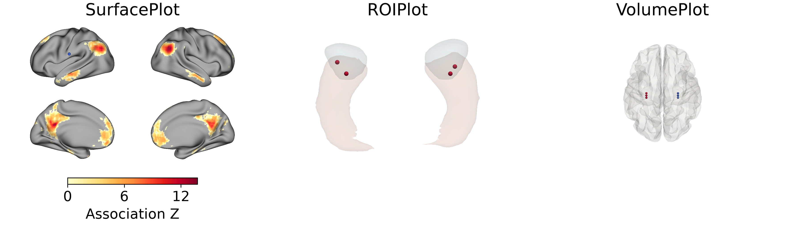

# anatplot

anatplot is a Python package for plotting data on brain surfaces and
visualizing anatomical regions in 3D. You can optionally add electrode
contacts to any plot, then save a Matplotlib figure or explore and export
the 3D scene.

## Choose a plot

| What you want to show | Use | Tutorial |
| --- | --- | --- |
| A cortical map or parcel labels on brain surfaces | `SurfacePlot` | [Surface basics](tutorials/surfaceplot-basics.md) |
| Selected regions from a labelled anatomical image | `ROIPlot` | [ROI tutorial](tutorials/roiplot.md) |
| A translucent whole-brain view that reveals contacts inside the brain | `VolumePlot` | [Volume tutorial](tutorials/volumeplot.md) |



`SurfacePlot` has the most complete workflow, though its API may still evolve.
`ROIPlot` and `VolumePlot` are under development.

## Install

Requires Python 3.10 or newer. Install from GitHub:

=== "uv"

    ```bash
    uv add "git+https://github.com/const7/anatplot.git"
    ```

=== "pip"

    ```bash
    pip install "git+https://github.com/const7/anatplot.git"
    ```

## Make your first figure

Draw a Neurosynth default-mode association map and a contact on inflated
cortical surfaces.

```python exec="on" source="above" id="homepage-output-directory"
from pathlib import Path  # markdown-exec: hide

Path("outputs/homepage").mkdir(parents=True, exist_ok=True)  # markdown-exec: hide
```

```python exec="on" source="above" html="on" id="first-figure" workdir="outputs/homepage"
import base64  # markdown-exec: hide
import io  # markdown-exec: hide
import matplotlib  # markdown-exec: hide

matplotlib.use("Agg")  # markdown-exec: hide
import matplotlib.pyplot as plt  # markdown-exec: hide

import numpy as np

from anatplot import SurfacePlot, datasets

surfaces = datasets.fetch_surfaces("fsLR", surface="inflated", density="32k")
left, right = datasets.fetch_dmn_map_fslr32k()
association = {
    "left": np.ma.masked_equal(left, 0),
    "right": np.ma.masked_equal(right, 0),
}

# The with block automatically closes the scene and releases graphics resources.
with SurfacePlot(
    **surfaces,
    views=["lateral", "medial"],
    # Show left/right hemispheres side by side, with outer views above inner views.
    layout="grid",
    window_size=(1000, 600),
    zoom=1.5,
) as plot:
    plot.add_layer(association, cmap="YlOrRd", cbar=True, cbar_label="Association Z")
    plot.add_contacts([[-64, -13, 23]], radius=4, color="royalblue")
    fig = plot.to_figure(figsize=(10, 7))

fig.savefig("surface-map.png", dpi=300)
buffer = io.BytesIO()  # markdown-exec: hide
fig.savefig(buffer, format="png", dpi=300)  # markdown-exec: hide
plt.close(fig)  # markdown-exec: hide
encoded = base64.b64encode(buffer.getvalue()).decode("ascii")  # markdown-exec: hide
print(  # markdown-exec: hide
    f''  # markdown-exec: hide
)  # markdown-exec: hide
```

## Acknowledgements

- **Design inspiration:** The design of `SurfacePlot`, especially its plotting
  workflow and default appearance, was strongly inspired by
  [surfplot](https://github.com/danjgale/surfplot).
- **Rendering and figures:** anatplot renders brain scenes with
  [PyVista](https://docs.pyvista.org/) / [VTK](https://vtk.org/) and composes
  figures with [Matplotlib](https://matplotlib.org/).
- **Public data:** [neuromaps](https://netneurolab.github.io/neuromaps/),
  [TemplateFlow](https://www.templateflow.org/),
  [Nilearn](https://nilearn.github.io/), and [NetNeuroLab](https://osf.io/udpv8/).
